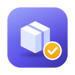

<p align="center"></p>

<h1 align="center">Облік майна</h1>

Програма для обліку майна: категорії й підкатегорії, довільні характеристики, фото, пошук і сортування.
Працює на **Windows, macOS і Linux** (Python + PySide6/Qt) — **у спільній хмарі** для команди
або **локально** на одному комп'ютері.

[](https://github.com/Mirakses/inventar/actions/workflows/build.yml)

## ⬇️ Завантажити

Готові версії лежать на сторінці [**Releases**](https://github.com/Mirakses/inventar/releases):

| Система | Файл | Як запустити |
|---|---|---|
| Windows | `Inventar-Windows.zip` | Розпакуйте й запустіть `Inventar.exe`. Якщо SmartScreen попередить, натисніть «Докладніше → Усе одно запустити». |
| macOS | `Inventar-macOS.zip` | Розпакуйте й перетягніть `Inventar.app` у «Програми». Під час першого запуску: правий клік → «Відкрити». |

## ✨ Можливості

- **Дерево категорій** з підкатегоріями та кольоровими мітками
- **Картка речі**: назва, категорія, інвентарний і серійний номер, розташування, кількість, ціна, дата покупки, стан, примітки
- **Характеристики** у вигляді пар «параметр — значення». Параметри, які вже є в категорії, підставляються автоматично
- **Фото**: кілька на кожну річ, додаються перетягуванням
- **Пошук** по всіх полях і характеристиках, **сортування** будь-якої колонки
- **Експорт у CSV** і **резервна копія** в ZIP

### ☁️ Спільна хмара (Supabase)

- **Вхід за запрошенням**: адміністратор додає email, людина реєструється сама. Сторонні зареєструватися не можуть
- **Ролі**:

  | Роль | Що може |
  |---|---|
  | Адміністратор | усе, включно з користувачами, запрошеннями й категоріями |
  | Редактор | додає, змінює й видаляє речі у своїх категоріях |
  | Комірник | видача й повернення: лише стан, розташування й кількість |
  | Переглядач | лише перегляд |

- **Доступ за категоріями**: кожному відкриваються лише вибрані категорії (разом із підкатегоріями)
- **Права перевіряє сервер** (Row Level Security), тож обійти їх зміною програми неможливо
- **Офлайн**: без інтернету програма працює з локальною копією, а зміни ставляться в чергу й відправляються, щойно з'явиться мережа
- **Історія змін**: хто, коли й що змінив у кожній речі

#### Власний сервер

1. Створіть безкоштовний проєкт на [supabase.com](https://supabase.com)
2. **SQL Editor** → виконайте [`supabase/schema.sql`](supabase/schema.sql)
3. Пошта для кодів підтвердження й зміни пароля — див. [«Пошта»](#-пошта-коди-підтвердження) нижче
4. У програмі: **👤 → Змінити сервер…** → вставте *Project URL* і ключ *anon public* (**не** service_role)
5. Перший зареєстрований користувач стає адміністратором

Права доступу можна перевірити тестами: `supabase/tests/run.sh` (потрібен локальний Postgres).

## ✉️ Пошта: коди підтвердження

Під час реєстрації й зміни пароля людина отримує на email 6-значний код і вводить його прямо в програмі.
Вбудована пошта Supabase надсилає листи лише учасникам проєкту, тому потрібна власна SMTP. Найпростіше — Gmail:

1. Google-акаунт → **Безпека** → увімкніть **двоетапну перевірку** → [**Паролі застосунків**](https://myaccount.google.com/apppasswords) → створіть пароль «Supabase»
2. Supabase → **Authentication → Emails → SMTP Settings** → *Enable custom SMTP*:
   хост `smtp.gmail.com`, порт `465`, логін і адреса відправника — ваш Gmail, пароль — пароль застосунку
3. **Authentication → Emails → Templates**:
   - *Confirm signup* — тема «Код підтвердження — Облік майна», текст із [`supabase/email/confirm_signup.html`](supabase/email/confirm_signup.html)
   - *Reset password* — тема «Код для зміни пароля — Облік майна», текст із [`supabase/email/reset_password.html`](supabase/email/reset_password.html)
4. **Authentication → Sign In / Providers → Email** → увімкніть *Confirm email*

## 🛠 Запуск із коду

```bash
git clone https://github.com/Mirakses/inventar.git
cd inventar
python -m venv .venv
source .venv/bin/activate        # Windows: .venv\Scripts\activate
pip install -r requirements.txt
python app.py
```

Збірка виконуваного файлу на своєму комп'ютері:

```bash
pip install pyinstaller
pyinstaller --windowed --name Inventar --icon assets/icon.icns --add-data "assets/icon.png:assets" app.py
# Windows: --icon assets/icon.ico
```

## 💾 Де зберігаються дані

| Система | Папка |
|---|---|
| Windows | `%APPDATA%\Inventar` |
| macOS | `~/Library/Application Support/Inventar` |
| Linux | `~/.local/share/Inventar` |

Іншу папку можна задати змінною середовища `INVENTAR_DATA`. Кнопка «Папка даних» у програмі відкриває поточну.

## 📁 Структура

```
app.py            головне вікно й діалог речі (PySide6)
ui_cloud.py       вхід, користувачі й запрошення, фонова синхронізація
cloud.py          робота з Supabase: вхід, права, синхронізація
db.py             локальна база SQLite (офлайн-копія) і фото
cloud_config.py   адреса сервера за замовчуванням (публічний ключ)
supabase/         серверна схема, тести прав доступу, шаблони листів
tests/            тести синхронізації (python -m tests.test_sync)
assets/           іконка програми
```

## 🚀 Випуск нової версії

1. Змініть номер у `app.py`: `__version__ = "0.2.0"`
2. Зробіть коміт і відправте його в `main`.

GitHub Actions збере програму для Windows і macOS і сам створить Release `v0.2.0` з готовими файлами.
Поки номер версії не змінюється, кожен коміт лише збирається, а нового релізу не з'являється.
